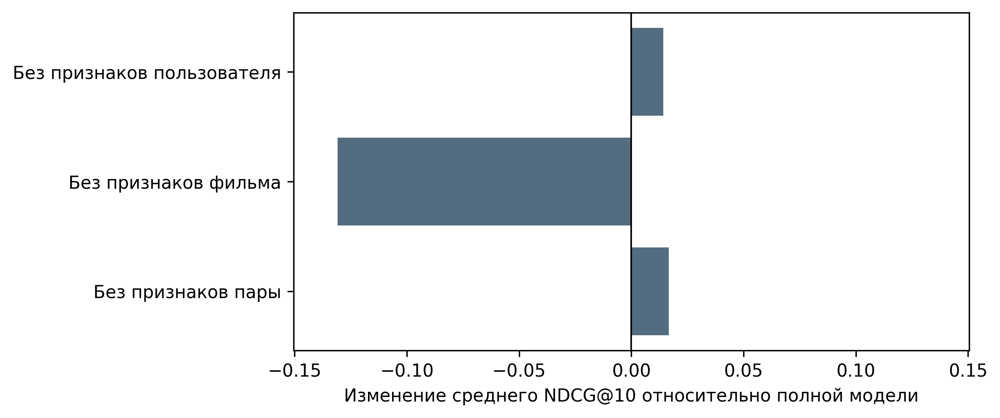
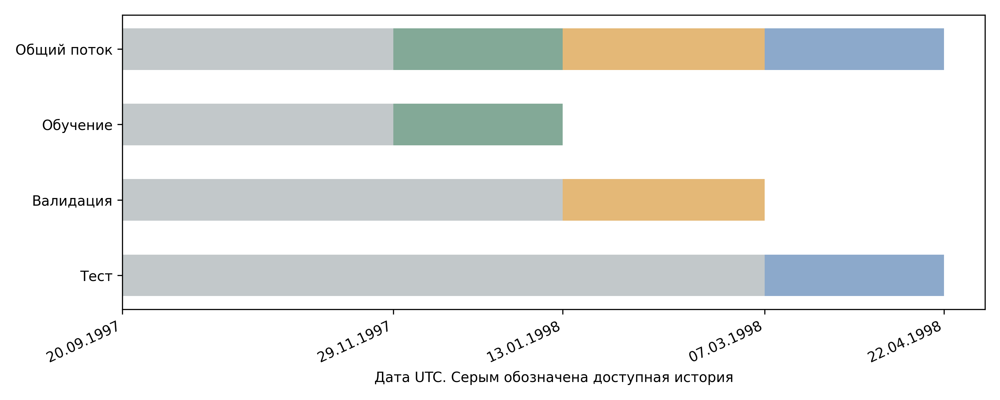

# MovieLens Ranking

Персонализированное ранжирование фильмов на MovieLens 100K. Проект сравнивает рекомендации по популярности, жанровому сходству и LightGBM Ranker, а затем проверяет вклад групп признаков в качество первой десятки.

## Результаты

Оценка выполнена на 95 пользователях и 137 296 кандидатных парах. Все модели ранжируют одинаковые списки ранее не оценённых пользователем фильмов.

| Модель | Precision@10 | Recall@10 | NDCG@10 |
|---|---:|---:|---:|
| Популярность | 0,12737 | 0,10782 | 0,15958 |
| Жанровое сходство | 0,04526 | 0,03051 | 0,05451 |
| LightGBM Ranker | 0,11053 | 0,09464 | 0,17293 |

Популярностная модель получила больше попаданий в первую десятку. LightGBM показал более высокий средний NDCG@10, который учитывает позиции релевантных фильмов.

| Вариант LightGBM | Признаки | NDCG@10 | Изменение относительно полной модели |
|---|---:|---:|---:|
| Полная модель | 28 | 0,17293 | 0,00000 |
| Без признаков пользователя | 25 | 0,18718 | +0,01425 |
| Без признаков фильма | 6 | 0,04211 | −0,13082 |
| Без признаков пары | 25 | 0,18970 | +0,01677 |



Удаление характеристик фильма вызвало наибольшее снижение качества. Три явных признака пары не дали прироста на этом разбиении. Вариант без них выделен по тестовым результатам и требует проверки на другом временном периоде. Эти числа описывают один эксперимент; устойчивое превосходство на других данных не установлено.

## Метод

Данные сортируются по времени выставления оценки. Границы по позициям 40 %, 60 % и 80 % отделяют начальную историю, обучение, валидацию и тест. События с одинаковой пограничной меткой времени входят в следующий период.



- Признаки строятся по истории строго до начала прогнозируемого периода.
- Каталог содержит ранее встречавшиеся фильмы. Уже оценённые пользователем объекты исключаются.
- Положительная метка означает оценку 4 или 5 в прогнозируемом периоде. Нулевая метка означает отсутствие такой записи за этот период.
- Для оценки отбираются пользователи с историей, минимум десятью кандидатами и хотя бы одним релевантным кандидатом. В тест попали 95 из 301 активного пользователя.
- Метрики рассчитываются для каждого пользователя и усредняются с равным весом.
- При равных баллах фильмы сортируются по идентификатору.

Пользовательские признаки включают число оценок, средний балл и долю положительных оценок. Характеристики фильма включают статистику оценок, сглаженную среднюю и 19 жанровых полей. Три признака пары описывают косинусное сходство жанрового профиля и пересечения жанров с историей пользователя.

LightGBM обучается с целью `lambdarank`. Группа соответствует пользователю на одну дату. Среди 30, 60 и 100 деревьев по валидационному NDCG@10 выбраны 30. Итоговое обучение объединяет два периода, сохраняя отдельные группы для каждой даты. В абляции каждая модель обучается заново с теми же параметрами.

## Запуск

Используйте Python 3.10. Зависимости фиксируют вычислительные библиотеки проверенного окружения, включая LightGBM 4.6.0.

```bash
python -m venv .venv
```

Активируйте окружение в PowerShell:

```powershell
.venv\Scripts\Activate.ps1
```

В Linux или macOS:

```bash
source .venv/bin/activate
```

Установите зависимости:

```bash
python -m pip install -r requirements.txt
```

Скачайте [архив MovieLens 100K](https://files.grouplens.org/datasets/movielens/ml-100k.zip) у GroupLens и поместите его в `data/ml-100k.zip`. Блокноты читают ZIP напрямую. Перед использованием ознакомьтесь с [условиями набора данных](https://files.grouplens.org/datasets/movielens/ml-100k-README.txt).

Из корня проекта запустите:

```bash
python -m jupyterlab
```

Выполняйте ячейки сверху вниз, последовательно открывая блокноты:

| Блокнот | Назначение | Результаты |
|---|---|---|
| `03_movielens_eda.ipynb` | Проверка данных, анализ активности, временные периоды | `results_stage3/` |
| `04_movielens_features.ipynb` | Построение признаков и разметка кандидатов | `results_stage4/` |
| `05_movielens_models.ipynb` | Обучение, выбор числа деревьев, оценка | `results_stage5/` |
| `06_movielens_ablation.ipynb` | Исключение групп признаков и пример выдачи | `results_stage6/` |

Рабочий каталог ядра должен совпадать с корнем проекта. Этапы создают промежуточные CSV, матрицы признаков, метрики по пользователям и графики. Перед обучением необходимо выполнить обработку данных и формирование признаков даже при наличии опубликованных сводных таблиц. Исходный архив и записи отдельных пользователей создаются или хранятся локально. В репозиторий включены код, агрегированные результаты и графики.

## Данные и ограничения

MovieLens 100K содержит 100 000 оценок от 943 пользователей для 1 682 фильмов. Исходный набор включает пользователей минимум с 20 оценками. Время относится к регистрации оценки; журнал показов отсутствует. Поэтому эксперимент проверяет совпадение выдачи с последующими высокими оценками и не измеряет причинный эффект рекомендаций.

Результаты относятся к пользователям, прошедшим отбор, и одному временному разбиению. В группе признаков фильма жанры и агрегаты удаляются совместно. Чтобы измерить их отдельный вклад, нужен дополнительный эксперимент.

Данные предоставлены GroupLens Research. Их распространение и коммерческое использование регулируются условиями владельца.

F. Maxwell Harper and Joseph A. Konstan. 2015. *The MovieLens Datasets: History and Context*. ACM Transactions on Interactive Intelligent Systems, 5(4), Article 19. [DOI 10.1145/2827872](https://doi.org/10.1145/2827872).
